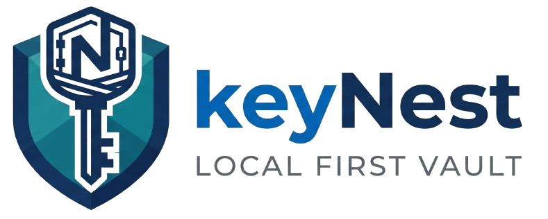

<div align="center">



<br />

**A local‑first credential vault that never phones home.**

Your passwords live in *your* browser. No server, no account, no sync - just an encrypted nest for your keys.

<br />

### [🚀 Launch the live app →](https://keynestapp.pages.dev)

<br />

[](https://keynestapp.pages.dev)
[](https://angular.dev)
[](https://www.typescriptlang.org)
[](#-why-local-first)

</div>

<br />

## ✨ What is KeyNest?

KeyNest is a single‑page credential manager built on a simple premise: **your secrets should never leave your device unless you explicitly send them.**

There is no backend to trust, no account to create, and no network request to leak. Every credential is stored in your browser's own [IndexedDB](https://developer.mozilla.org/en-US/docs/Web/API/IndexedDB_API) via [Dexie](https://dexie.org/). When you *want* to share one, KeyNest encrypts it in‑browser and packs the secret into the URL fragment - a part of the link the server never even sees.

<br />

## 🎯 Features

| | |
|---|---|
| 🗄️ **Local‑first storage** | Credentials persist in IndexedDB. Close the tab, come back later - they're still there, still yours. |
| 🔐 **Encrypted share links** | Share a single credential via a self‑contained link, encrypted with AES‑256‑GCM using the Web Crypto API. |
| 🔎 **Instant search** | Filter your vault as you type. |
| 📦 **Backup & restore** | Export your whole vault to a JSON file and import it anywhere - portable and offline. |
| 🚫 **Duplicate guarding** | Case‑insensitive name checks stop you from nesting the same key twice. |
| 🎨 **Crafted UI** | Deep‑navy canvas, elevated cards, and a considered token‑driven design system. |

<br />

## 🛡️ Why local‑first?

Most password tools ask you to hand your secrets to *their* servers and *their* security posture. KeyNest flips that:

- **No backend.** There is no server-side code - nothing to breach, subpoena, or bill you for.
- **No account.** Nothing to sign up for, nothing to phone home.
- **No telemetry.** The app makes zero network calls with your data.
- **You own the file.** Backups are plain, portable JSON that you control.

The trade‑off is honest: your vault lives in one browser profile. Backups are how you move between devices - deliberately, on your terms.

<br />

## 🔗 How sharing works

Sharing is the one time a credential leaves your vault - and even then, the server never sees the secret.

```
        ┌─────────────────────────────────────────────────────────┐
        │  .../share/github#<version><iv><key><ciphertext>         │
        └───────────────────────────┬─────────────────────────────┘
                    slug (display)   │   URL fragment - never sent to any server
                                     ▼
        AES‑256‑GCM · encrypted in your browser · Web Crypto API
```

1. KeyNest generates a fresh **AES‑256‑GCM** key and encrypts the username + password entirely in your browser.
2. The version byte, IV, raw key, and ciphertext are packed into a compact binary blob and placed in the URL **fragment** (`#…`).
3. Because browsers never transmit the fragment over the network, the secret is readable only by whoever holds the *complete* link.
4. Opening the link decrypts the payload client‑side and shows the credential — with the option to save it into that browser's own vault.

> A share link is a bearer token: anyone with the full URL can read it. Send it over a trusted channel, and don't paste it where servers log full URLs.

<br />

## 🚀 Getting started

**Prerequisites:** [Node.js](https://nodejs.org) 20+ and npm.

```bash
# 1. Install dependencies
npm install

# 2. Start the dev server
npm start
```

Then open **http://localhost:4200** - the app hot‑reloads as you edit.

<br />

## 🧰 Scripts

| Command | What it does |
|---------|--------------|
| `npm start` | Run the dev server at `localhost:4200` with live reload. |
| `npm run build` | Production build, optimized into `dist/`. |
| `npm run watch` | Development build that rebuilds on change. |
| `npm test` | Run unit tests with [Vitest](https://vitest.dev). |

<br />

## 🏗️ Tech stack

- **[Angular 21](https://angular.dev)** — standalone components, signals, and `OnPush` change detection throughout.
- **[Dexie](https://dexie.org/)** — a graceful wrapper over IndexedDB for local persistence.
- **[Web Crypto API](https://developer.mozilla.org/en-US/docs/Web/API/Web_Crypto_API)** — native AES‑256‑GCM, no crypto libraries in the bundle.
- **[Lucide](https://lucide.dev)** — clean, consistent iconography.
- **[Vitest](https://vitest.dev)** — fast unit testing.
- **TypeScript 5.9** in strict mode.

<br />


<div align="center">

Made with care · **KeyNest** - *Local First Vault*

</div>
